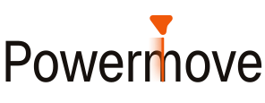
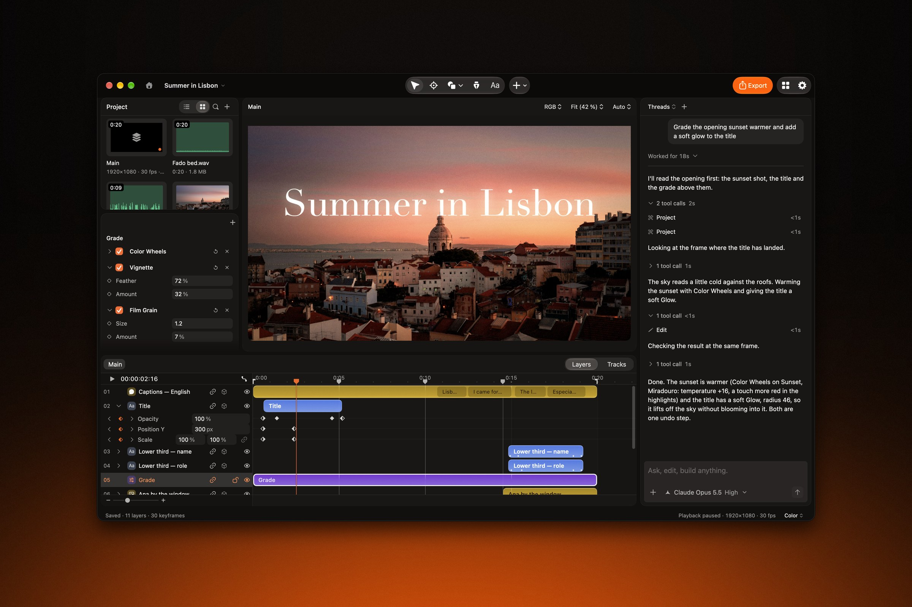
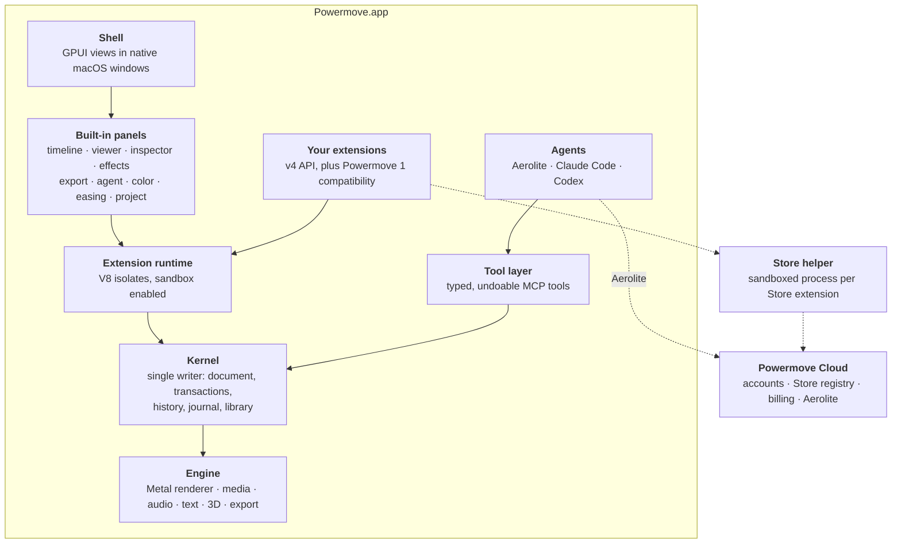

<div align="center">

<picture>
  <source media="(prefers-color-scheme: dark)" srcset="assets/brand/powermove-wordmark-dark.svg">
  
</picture>

<br>

**The video editor that lets you do *anything*.**

Make it yours while you edit. A free, open-source motion and video editor for Apple silicon Macs —<br>
ask an agent to build any effect, tool, or panel right inside the app.

[Website](https://trypowermove.com) · [Download for Mac](https://github.com/iterative-computer/powermove/releases/latest) · [Discord](https://discord.gg/6ebptZF3Ch)

[](https://trypowermove.com)
[](apps/native/rust-toolchain.toml)
[](LICENSE)

</div>

<br>

<p align="center">
  
</p>

<br>

## Welcome to malleable software

Most video editors ship a fixed feature set and a plugin SDK for the brave. Powermove flips that around: it's a native motion and video editor with an AI agent that builds what's missing while you edit.

- **Customize anything with AI.** Ask an agent to generate effects and shaders, build custom panels, or restyle the workspace — changes land live inside the running app.
- **A deliberately tiny kernel.** Panels, effects, transitions, themes, and keymaps are all extensions built on a small core. New extensions use the exact same API as the built-in ones.
- **Blazing fast, native all the way down.** Written in Rust with a GPUI interface and Metal GPU engine (no Electron, no Chromium). On identical 1080p timelines, Powermove uses over 6× less RAM than After Effects (`660 MB` vs `4.10 GB`), scrubs smoothly without waiting on RAM previews (`65 fps` vs `18 fps`), and exports MP4 over 3× faster (`2.8 s` vs `10.2 s`).
- **Every change is reversible.** Agent edits go through the same undo history as your own, and **Undo Extension Change** rolls back any extension edit in one step.

```text
 ┌─────────────────────────────────────────────────────────────────────────┐
 │  Your mods                Yours to add. Same API as everything below    │
 ├─────────────────────────────────────────────────────────────────────────┤
 │  Panels                   Timeline, inspector, agent, media             │
 ├─────────────────────────────────────────────────────────────────────────┤
 │  Effects and transitions  Blur, grain, whip pan, dissolve               │
 ├─────────────────────────────────────────────────────────────────────────┤
 │  Theme and keymap         Your look, your shortcuts                     │
 ╞═════════════════════════════════════════════════════════════════════════╡
 │  Kernel                   Project store, typed edits, undo, compositor  │
 └─────────────────────────────────────────────────────────────────────────┘
```

## What's inside

| | |
| --- | --- |
| **Motion & timeline** | Layers, keyframes, easing curves, and GPU effects on a native timeline, with the agent in a panel right beside them. |
| **Pro editing** | Ripple trims and deletes, slip, slide, split, and shuttle, with keymap presets for After Effects (default), Premiere Pro, Final Cut Pro, and DaVinci Resolve. |
| **Custom effects** | Fork built-in GLSL effects and transitions, or ask the agent to write new ones from a description. |
| **Media & caching** | FFmpeg (pinned LGPL build) and VideoToolbox hardware decoding, proxies, and a background render cache. |
| **Captions** | On-device speech-to-text transcription that runs locally on your Mac. |
| **3D Studio** | Compose 3D scenes directly inside your video compositions. |
| **Export** | MP4, WebM, and ProRes video with audio, still frames, PNG sequences, or a self-contained project — rendered out-of-process so the editor stays responsive. |
| **Only what you need** | Toggle any extension off in Settings when you don't need it, and back on whenever you do. |

Coming from Powermove 1? On first launch, Powermove copies your library and extensions over automatically while leaving your original profile untouched.

## Agents and plans

Powermove works with its built-in **Aerolite** agent as well as your own **Claude Code** or **Codex** subscription. Every agent edits through the same undoable tool layer and renders frames to inspect its own work.

| Agent | What it is | Sign-in |
| --- | --- | --- |
| **Aerolite** | Powermove's built-in AI agent. Pick a model and effort level per thread. | Powermove account (Aerolite plan) |
| **Claude Code** | Anthropic's coding agent, bundled with the app. | Your own Claude Code subscription |
| **Codex** | OpenAI's coding agent, bundled with the app. | Your own Codex subscription |

Claude Code and Codex use your own credentials and never proxy through Powermove.

### Plans

| | Free | Powermove Aerolite |
| --- | --- | --- |
| **Price** | $0 | $9.99 / month |
| **Best for** | The full editor, with your own agent | Built-in intelligence |
| **Includes** | Every tool, effect, and export · Store extensions or agent-built mods · Bring your Claude Code or Codex subscription | Everything in Free, plus **1,000 AI credits monthly** · Review links *(soon)* · Cloud projects *(soon)* |

Prices are in US dollars. Credits do not roll over — see [docs/native/aero-inference.md](docs/native/aero-inference.md) for details.

## Extensions and the Store

An extension is a folder containing a manifest and a TSX entry point:

```json
{
  "id": "hello-panel",
  "name": "Hello",
  "version": "1.0.0",
  "apiVersion": 4,
  "entry": "index.tsx",
  "author": "agent"
}
```

Panels are written in JSX against the `powermove-v4` API, run inside isolated V8 sandboxes, and draw natively. Before an agent's extension goes live, Powermove validates its files, scans for credentials, compiles its TypeScript and shaders, and runs a smoke test in a throwaway runtime — then hot-reloads every open window in under a second.

The **Store** lets editors share extensions. Store extensions run in separate, sandboxed helper processes with isolated storage, apart from the editor and from each other. Powermove 1 extensions continue to run in a compatibility realm.

- Authoring guide: [apps/native/js/v4/api-pack/EXTENSIONS.md](apps/native/js/v4/api-pack/EXTENSIONS.md)
- Starter template: [apps/native/js/v4/api-pack/samples/hello-panel](apps/native/js/v4/api-pack/samples/hello-panel)
- API reference: [docs/native/v4-api.md](docs/native/v4-api.md)

## Architecture



The kernel is the single writer to every project. Panels, extensions, and agents all commit through typed transactions, so a drag on the timeline and a multi-step agent edit share one history and one undo stack.

Further reading: [native engine design](docs/rust-engine.md) ·
[kernel](docs/native/kernel.md) · [shell](docs/native/shell.md) ·
[MCP tools](docs/native/mcp.md) · [design language](docs/design.md) ·
[all docs](docs/README.md)

## Repository layout

```text
apps/
  native/        The macOS app: Rust workspace (crates/), in-app JS (js/), vendored GPUI,
                 taffy, and Aerolite's core (vendor/), plus bundle and packaging scripts
  cloud/         Powermove Cloud: Hono Worker on Cloudflare for accounts, Store, billing
                 (Stripe), and Aerolite
  www/           trypowermove.com, a prerendered SvelteKit site on Cloudflare Workers
  admin/         Admin panel, SvelteKit on Cloudflare Workers
engine/          The native engine (second Rust workspace): Metal render, media, audio,
                 text, color, export, 3D, and a pinned LGPL FFmpeg build (third_party/)
packages/
  registry/      Store contract shared by the app and cloud: manifest, snapshots, wire schemas
  tokens/        Design tokens shared by the website and admin panel
  player/        Web composition player package
  macos-haptics/ Native macOS haptics addon
tools/           Verification tooling: performance gates, visual parity, extension checks
docs/            Design language, engine and native architecture notes, telemetry
```

<details>
<summary><b>Inside <code>apps/native/crates</code></b></summary>

| Area | Crates |
| --- | --- |
| App and interface | `app` (the `powermove-native` binary), `shell`, `design`, `surface`, `wave`, `first-launch` |
| Project model | `kernel`, `migrate`, `services` |
| Panels | `builtins`, `panel-timeline`, `panel-inspector`, `panel-media`, `panel-viewerchrome`, `panel-agentpanel`, `panel-studio3d` |
| Engine bridge | `engine-service`, `promedia`, `scene3d`, `studio3d-engine`, `transcribe` |
| Extensions | `runtime-v8`, `compat-runner`, `compat-host`, `remote-dom`, `store-host`, `recorder` |
| Agents and automation | `agents`, `aero-core`, `aero-eval`, `mcp` |
| Quality and telemetry | `acceptance`, `telemetry` |

</details>

## Build from source

Powermove builds on **macOS 14 or later on Apple silicon**. Prerequisites:

- Xcode Command Line Tools: `xcode-select --install`
- [rustup](https://rustup.rs) — each Rust workspace pins **Rust 1.96.1** in `rust-toolchain.toml`, installed automatically on first use.
- [bun](https://bun.sh) **1.3.14** — the only package manager in the repo (also invoked by the Rust build to bundle built-in panels).
- Build tools for pinned media libraries: `brew install cmake ninja pkg-config autoconf automake libtool xz python`

### 1. Environment and JavaScript dependencies

```sh
source engine/env.sh                    # rustup first on PATH, build settings, PM_FFMPEG_DIR
export CARGO_TARGET_DIR="$PWD/target"   # shared target folder so helpers land beside the app

bun install --frozen-lockfile
for d in v4 compat remote-dom; do (cd "apps/native/js/$d" && bun install); done
```

### 2. Pinned native dependencies (one-time)

```sh
# Powermove's LGPL-only FFmpeg, built reproducibly from checksummed sources
PM_FFMPEG_OUT="$PM_FFMPEG_DIR" engine/third_party/ffmpeg/build.sh

# Pinned Zig for Aerolite's core (without it, Aerolite builds as an unavailable stub)
apps/native/vendor/fx/install-zig.sh
```

The extension runtime links `rusty_v8` 152.2.0 with the V8 sandbox enabled. Build that archive with the [`Native V8 sandbox spike`](.github/workflows/native-v8.yml) workflow, then point the build at its artifact:

```sh
export RUSTY_V8_ARCHIVE=/path/to/librusty_v8.a
export RUSTY_V8_SRC_BINDING_PATH=/path/to/src_binding.rs
```

### 3. Build the app and helpers

The first build compiles pinned `dav1d`, OpenEXR, and JPEG libraries into `~/Library/Caches/powermove-engine`.

```sh
(cd apps/native && cargo build --locked -p pm-native-app)
(cd apps/native && cargo build --locked -p pm-runtime-v8 --features macos-sandbox --bin pm-store-helper)
(cd engine && cargo build --locked -p pm-glsl --bin pm-glsl-compiler)
```

`pm-glsl-compiler` compiles effect shaders and `pm-store-helper` isolates Store extensions; both must sit alongside the app binary.

### 4. Run a development build

```sh
apps/native/scripts/bundle-dev.sh "$CARGO_TARGET_DIR/debug/powermove-native" build/dev
build/dev/Powermove.app/Contents/MacOS/powermove-native --profile "$HOME/Powermove Dev"
```

`bundle-dev.sh` assembles a development `Powermove.app` with helpers, bundle resources, and your installed `claude` and `codex` CLIs. Development builds require an explicit `--profile` directory so they never touch your real library.

### Tests and other workspaces

```sh
(cd apps/native && cargo test --locked -p pm-kernel)   # run tests for any native crate
(cd apps/native/js/v4 && bun test)                     # extension API and built-in panels
bun run test                                           # all JavaScript workspaces
bun run typecheck

bun run dev:www                                        # website on http://localhost:5173
(cd apps/cloud && bun run local:billing)               # cloud, Stripe, and AI stand-ins locally
```

The local cloud stack requires Docker. See [apps/cloud/README.md](apps/cloud/README.md) for database migrations and local billing/AI stand-ins; [apps/admin/README.md](apps/admin/README.md) runs against the same stack.

## Contributing

Issues and pull requests are welcome. For larger changes, open an issue or stop by [Discord](https://discord.gg/6ebptZF3Ch) first.

- Work on a branch (`feat/…`, `fix/…`), not directly on `main`. Pull requests are merged rather than squashed, so keep each commit self-contained.
- Run checks for what you changed: `cargo fmt`, `cargo clippy`, and `cargo test` for Rust; `bun run typecheck` and `bun run test` for JavaScript.
- UI changes follow the [design language](docs/design.md). Keep nested corners concentric (`Outer R = Inner R + Padding`).
- Read [AGENTS.md](AGENTS.md) before your first commit — it's short and applies to both people and agents.

## Security

This repository is public. Never commit credentials, session cookies or tokens, private keys, database URLs, user data, or private reports. Sensitive configuration lives in Worker and GitHub secrets, never in Git.

Enable the secret-scanning pre-commit hook once per clone:

```sh
git config core.hooksPath .githooks
```

The hook runs [gitleaks](https://github.com/gitleaks/gitleaks) on every commit (you can also run `gitleaks git --pre-commit --staged --redact --ignore-gitleaks-allow` manually). If a real secret is ever exposed, revoke or rotate it immediately — deleting a file does not remove it from Git history.

**Reporting a vulnerability:** email [hello@iterative.computer](mailto:hello@iterative.computer) with "Security" in the subject rather than opening a public issue.

## Privacy

Powermove collects anonymous usage, crash, hang, and performance diagnostics so we can fix what breaks. You can disable this anytime in **Settings › Privacy**. Every event and property is documented in [docs/telemetry.md](docs/telemetry.md).

## License

Powermove is free software: the app, engine, cloud, website, and packages are licensed under the [GNU Affero General Public License v3.0 or later](LICENSE). Vendored third-party code keeps its own license in the `LICENSE` and `POWERMOVE.md` files alongside it.

<br>

<div align="center">
<sub>Made by <a href="https://iterative.computer">Iterative Computer</a> · <a href="https://trypowermove.com">trypowermove.com</a></sub>
</div>
